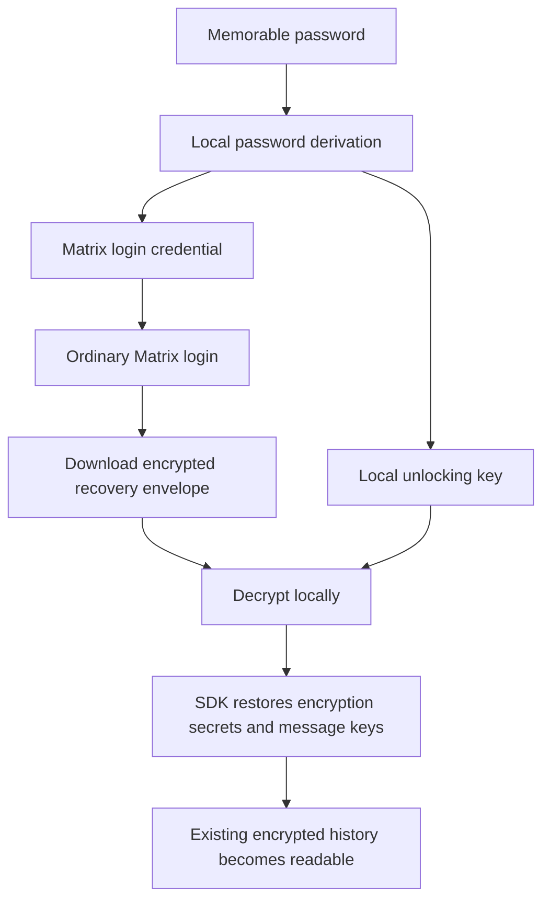

# Pax authentication design

Status: phase-one Pax signup and automatic password login are implemented for testing. Existing-account conversion, password changes, emergency/credential export, and signed discovery remain future work.

This document records the product behavior, implemented version-one formats, and security boundaries. The custom composition still needs cryptographic review and device benchmarking before production rollout. The integration tests use actual SDK-generated Secret Storage and encrypted message-key backups served by a local test homeserver; testing against the deployed homeserver remains necessary.

Standard Matrix password login, persistent local key storage, encrypted message-key backup, recovery-key restoration, and verification of the user's devices remain available.

## 1. Product requirements

Pax should provide the experience of installing an ordinary chat application: enter an account name and password, sign in, and see existing conversations. Routine use on a new installation must not require finding a separate recovery key or keeping another device online.

- The login screen has one account field, one password field, and a sign-in button. It does not ask users to choose an authentication scheme.
- New accounts default to the Pax single-password scheme. Account creation may offer an advanced option to use a standard Matrix password instead.
- Existing Matrix accounts continue to work with their existing authentication and encryption recovery behavior. They change schemes only through an explicit conversion while signed in.
- Account-type discovery and key restoration happen automatically.
- An incorrect password, unavailable server, app update, or expired access token must not reset the encryption identity, replace an existing backup, or delete locally held keys.
- Backup and restoration failures must be visible and retryable. Successful authentication must not be presented as proof that historical message keys have been restored.
- This design concerns access to the account's existing history. Sharing encrypted history with newly joined room members is a separate feature.

The automatic history-unlock experience applies to Pax-mode accounts with a completed recovery setup and the necessary message keys backed up. A standard Matrix account retains standard Matrix recovery requirements until converted.

## 2. Account schemes and terminology

| Name | Meaning |
| --- | --- |
| Standard Matrix account | The entered password is the account's actual Matrix password. Encryption recovery remains separate. |
| Pax single-password account | The entered password derives a Matrix login credential and a separate key for unlocking recovery information. |
| Memorable password, `P` | The password the user enters and remembers. In Pax mode, it must remain on the client. |
| Canonical account ID, `U` | The full Matrix user ID, such as `@alice:example.org`. |
| Login credential, `C` | A deterministic value derived by Pax and used as the actual Matrix password. |
| Unlocking key, `K_wrap` | A different derived value used only to decrypt the recovery envelope. |
| Recovery secret, `R` | The randomly generated Matrix Secret Storage key accepted by the SDK's recovery API. |
| Recovery envelope | An authenticated, encrypted representation of `R`, stored in private account data. |
| Authentication descriptor | Public metadata identifying the account, scheme, derivation profile, and credential revision. |

The login credential is calculated, not downloaded or decrypted. The unlocking key is also calculated; it does not need permanent storage.

The Matrix Secret Storage key is distinct from the backup decryption key stored inside Secret Storage. The SDK uses these secrets to restore room/session keys, which decrypt messages. The recovery secret is not used directly to decrypt every chat message.

## 3. Server responsibilities

The initial deployment assumes a trusted, configured homeserver with password authentication, custom public profile fields, private account data, and encrypted key-backup support.

| Component | Responsibility |
| --- | --- |
| Pax client | Derivation, discovery policy, password handling, envelope encryption/decryption, SDK recovery, and setup resumption. |
| Homeserver authentication | Validate `C` as an ordinary Matrix password for a Pax account, or the entered password for a standard account. |
| Public profile API | Store and serve the authentication descriptor before login. |
| Private account-data API | Store and serve the encrypted recovery envelope after login. |
| Matrix key-backup API | Store encrypted copies of message keys. |
| Future independent issuer | Authorize account schemes and provide the authenticity and freshness needed for signed discovery. |

The homeserver does not need to understand the derivation algorithm or decrypt an envelope. Phase one uses ordinary Matrix interfaces, subject to verifying support on the deployed server. It does not introduce a new Matrix login type.

## 4. Security phases

### Phase one: unsigned discovery on trusted homeservers

Unsigned public authentication descriptors are permitted for the baked-in `PAX_HOMESERVER`. Pax enrollment is refused on other servers when that setting is present; standard Matrix accounts remain usable. Development builds with no default configured treat an explicitly entered HTTPS homeserver as a user trust choice. The initial target is the project's own homeserver. Pax mode requires HTTPS in application builds.

This phase trusts the homeserver to report the account scheme honestly. It does not protect a Pax password against an actively malicious homeserver that falsely selects standard password login. Message encryption and encrypted key backups remain enabled, but this trust decision weakens protection against that particular server attack.

A stolen database may also permit offline password guessing. A memorable password does not gain the entropy of a random recovery key merely because it passes through a derivation function.

### Later phase: signed discovery

Signed discovery is deferred, not implicitly provided by unsigned records. The policy deciding whether signatures are required belongs to the client or independently trusted configuration. The homeserver cannot turn enforcement off by adding an `unsigned` flag to its response.

Signed-mode requirements are specified in section 12. A client that requires signed discovery must reject an unsigned deployment rather than silently weaken its policy.

Neither phase protects against a compromised client, a malicious application update, or theft of an already unlocked device. Availability also depends on retaining messages, attachments, and key backups on the server.

## 5. Derivation algorithm

The Pax-mode flow is:



### Required properties

The derivation must:

1. Produce the same login credential on a fresh installation from the same password and canonical account ID.
2. Make the unlocking key computationally independent of the login credential, except through guessing the memorable password.
3. Use a password-hardening function; a single fast hash is insufficient.
4. Separate authentication and encryption with distinct, versioned purpose labels.
5. Have exact, stable input encodings and bounded resource costs across supported platforms.

The login credential must be computable without fetching private account data. Otherwise authentication would depend on data available only after authentication.

### Implemented version-one construction

The derivation profile is `pax-password-v1`. All arrays below are compact JSON arrays of strings, serialized as UTF-8 without extra spaces. String escaping follows `serde_json`; Unicode is preserved as UTF-8. Passwords use their exact UTF-8 bytes, without trimming or Unicode normalization.

```text
salt   = SHA256(JSON(["pax.password-salt", "v1", U]))
master = Argon2id-v19(UTF8(P), salt, memory=65536 KiB, iterations=3, lanes=1, output=32 bytes)
prk    = HKDF-Extract-SHA256(salt=ASCII("pax.hkdf.v1"), IKM=master)
K_auth = HKDF-Expand-SHA256(prk, JSON(["pax.matrix-login", "v1", U]), 32 bytes)
K_wrap = HKDF-Expand-SHA256(prk, JSON(["pax.recovery-unlock", "v1", U]), 32 bytes)
C      = "Pax1!" + base64url_without_padding(K_auth)
```

`C` is 48 ASCII bytes, below bcrypt's 72-byte password truncation boundary. New Pax passwords require at least 12 Unicode scalar values; login does not reapply that signup constraint. Derivation runs in a native blocking task, outside the UI thread. The implementation uses RustCrypto Argon2, HKDF, SHA-256, XChaCha20-Poly1305, and best-effort zeroization of derived/recovered secrets. Neither JSON/IPC serialization nor ordinary language/runtime memory provides a guarantee that all temporary secret copies are erased.

Frozen synthetic interoperability vector:

| Input/output | Value |
| --- | --- |
| `U` | `@alice:example.org` |
| `P` | `four unrelated words 🔐` |
| `C` | `Pax1!Ji_0bqSl8AZPOFxW2TRjlOEVDDD5doxnjTjaikh_b-U` |
| Base64url `K_wrap` | `-jFAnBAxQShomFRiN8Gg7TVGhNV05cKXWT9QQ2PmZX4` |

These constants define this profile. They must not be adjusted for existing accounts without implementing a new version and an explicit credential migration. The deterministic account-derived salt is public; its limitations and the custom composition require review. It permits deriving credentials even when registration was interrupted before profile publication. Random authentication salts would require another reliable pre-login source.

`U` must be resolved consistently before derivation. A homeserver URL hostname is not necessarily the server-name portion of a Matrix user ID. Changing a deployment URL must not change a user's derived credential. For the initial deployment, Pax resolves local input against `server_name` from the ordinary `GET /_matrix/key/v2/server` response. If that endpoint is unavailable at the client URL, the app build can set `PAX_SERVER_NAME` for its configured homeserver; this is client configuration, not a homeserver extension. Full Matrix IDs supplied at login need no domain lookup. Never infer the account domain from the client URL hostname. Login and registration responses must match the expected Matrix user ID.

The server-provided profile may select only a derivation version already implemented and allowed by the client. It cannot supply arbitrary code, reduce hardening costs, or request unbounded memory or CPU work.

## 6. Public authentication descriptor

Profile field: `com.carter.pax.authentication`, following the application's existing identifier namespace.

Read it through the ordinary unauthenticated profile API. Publishing it requires an authenticated profile update and support for custom profile fields.

A version-one Pax descriptor is:

```json
{
  "schema_version": 1,
  "user_id": "@alice:example.org",
  "mode": "pax-password",
  "derivation_profile": "pax-password-v1",
  "credential_revision": 1,
  "state": "ready"
}
```

An explicit standard account uses `mode: "matrix-password"` and has no Pax password-derivation profile. Transition records are discussed in section 10; their final schema is an implementation gate.

Parsing rules:

- Bind the descriptor to the exact account being queried. Do not follow an arbitrary account or authentication-server redirect embedded in this field.
- Validate the schema version, mode, state, derivation profile, and field types before choosing a login path.
- Unknown versions or malformed descriptors are errors, not indications of a standard account.
- Store no passwords, login credentials, unlocking keys, recovery secrets, or password-verification tokens in the public field.
- Signature material, when introduced, covers the defined authentication descriptor. Ordinary avatar and display-name changes do not require signing.

The descriptor reveals the authentication scheme publicly. That is acceptable for this design; confidentiality must depend on secrets, not on hiding the scheme.

## 7. Private recovery envelope

Account-data type: `com.carter.pax.recovery`.

The envelope contains the Matrix Secret Storage key, encrypted under `K_wrap`. Account-data authentication controls who can download it; authenticated encryption controls who can read or alter its contents. These are separate protections.

The version-one envelope header identifies:

- `schema_version: 1`; the cipher suite is fixed by `derivation_profile: "pax-password-v1"`.
- The full Matrix user ID.
- The credential revision and derivation profile.
- The Matrix Secret Storage key ID.
- A fresh random nonce.

The encrypted plaintext is the exact UTF-8 SDK recovery-key string. XChaCha20-Poly1305 uses a fresh random 24-byte nonce on every encryption. The `nonce` and `ciphertext` fields use unpadded base64url; the ciphertext includes the authentication tag. Associated data is the compact UTF-8 JSON array `["pax.recovery-envelope", "v1", U, "pax-password-v1", "1", secret_storage_key_id]`. The header also has `user_id`, `credential_revision: 1`, and `secret_storage_key_id`. All header bindings are validated before decryption, including equality with the server's current default Secret Storage key ID. Ciphertext strings larger than 4096 bytes and non-24-byte nonces are rejected. An envelope copied to another account or edited by the server must not be accepted. Never reuse a nonce with the same key.

After decryption, Pax passes the recovery secret to the Matrix SDK. It must verify that the recovered secrets belong to the expected account and identity. A decryption or SDK-import failure must not trigger creation of a new identity or replacement backup.

The recovery secret remains random and independent of the password. A password change re-encrypts that same secret; it does not require re-encrypting every message.

The record format must support staged envelopes during credential changes. It must retain a working envelope until its replacement has been verified. The exact slot format and cleanup rules are not frozen yet.

## 8. Automatic login selection

Every login begins by identifying the account and applying its homeserver trust policy. Session restoration with existing tokens and the original local SDK store takes precedence over a new password login.

For a password login:

1. Fetch the public profile and validate the authentication descriptor under the configured trust policy.
2. For `pax-password`, derive `C` and `K_wrap`; send only `C` to Matrix.
3. For an authorized `matrix-password` account, perform ordinary Matrix password login.
4. Verify the returned account ID before accessing local stores or recovery data.
5. On a successful Pax login, fetch the private recovery envelope, decrypt it locally, and restore secrets through the SDK.
6. Restore historical room keys automatically as conversations are read, and refresh affected timelines when keys arrive.
7. Continue automatic encrypted key uploads while signed in.

The UI remains the same for both account schemes. No login-type selector or mode-choice retry prompt is introduced.

Pax should remember an account's successful Pax-mode enrollment locally. On that installation, an absent descriptor or a later claim of standard mode must not silently downgrade the account. This improves continuity on existing installations; it does not establish trust on a fresh installation or replace signed discovery.

### Existing accounts without descriptors

A missing field in a successfully fetched profile is not cryptographic proof of a standard account. The rollout must explicitly decide how such accounts are enrolled.

The preferred rollout is to publish explicit standard-account descriptors for existing accounts before enforcing descriptor-based login. Operational support for this backfill must be established on the deployed homeserver.

If phase one permits treating a successful profile response without the field as standard, that is an explicit, per-homeserver trusted-legacy policy. It inherits the unsigned downgrade risk. It is not a rule for arbitrary homeservers and must not carry over into signature-required mode.

The initial configured trusted-server deployment enables this compatibility policy: a deterministic Pax credential is tried first to help recover an interrupted Pax registration. A failed derived attempt does not identify the account type: an ordinary-password attempt is authorized only by the independently selected trusted-legacy policy and successful metadata lookup. Failure alone never authorizes fallback.

Timeouts, TLS failures, malformed responses, forbidden lookups, rate limits, and server failures remain errors. A profile `404` can mean either an unknown account or missing profile information; it must not silently authorize an ordinary-password attempt. Compatibility with legacy accounts returning `404` must be resolved through enrollment or an explicit deployment policy before rollout.

## 9. Account creation

### Pax account, the default

1. Determine the canonical account ID and collect a memorable password.
2. Derive `C` and `K_wrap` locally. Send `C`, never the memorable password, during Matrix registration.
3. Publish the Pax authentication descriptor as soon as authentication is available.
4. Establish the encryption identity, Secret Storage, and encrypted message-key backup through the SDK.
5. Obtain the random Secret Storage recovery key, encrypt it into the private envelope, and upload it.
6. Read the descriptor and envelope back, verify decryption and SDK recovery, and confirm that key backup is active.
7. Mark enrollment complete. Clear temporary password material when it is no longer needed.

A separate recovery-key save or device-verification ceremony is not part of the successful default enrollment flow. Emergency/credential exports are not implemented yet. Until then, the signup help explicitly explains the other-client and forgotten-password limitations.

Matrix registration, profile updates, and account-data updates are separate requests. The client must persist a setup journal containing non-secret progress and preserve the original crypto store. It must not claim enrollment is complete until the public descriptor and private envelope are verified.

The journal must not contain the memorable password or an unencrypted recovery secret. Where resuming setup requires a secret, use the preserved SDK store, protected platform storage, or re-entry of the memorable password.

If registration succeeds but descriptor publication fails, the deterministic credential allows Pax-mode authentication without that descriptor. Automatic discovery on another installation must not accidentally send the memorable password because of the partial registration. On the original installation, a non-secret account pin forces derived authentication and permits resuming the original device. On a fresh installation, a successful profile lookup with no descriptor permits the trusted-legacy derived probe; a derived success selects Pax. If publication is unavailable and lookup returns an error, a fresh installation stops rather than sending the memorable password. Finish setup on the original installation. The narrow response-loss window before registration success is durably journaled remains a deployment limitation; never initialize an established account merely because recovery data is missing.

### Standard Matrix account, optional

Use ordinary Matrix registration, publish a standard-account descriptor, and retain ordinary Matrix encryption recovery behavior. The account-creation option must explain that standard sign-in credentials remain compatible with other Matrix clients and that automatic history unlocking is not supplied by this scheme.

Pax registration checks Matrix 1.16 profile support before creating the account. Registration UIAA supports registration-token and dummy stages; unsupported flows return an explicit error. The original registration token/device session is restored into its own SDK store, avoiding an unnecessary second device. The account pin and pending session are saved before encryption setup. A failed setup displays “account created” and offers sign-in to finish. Token restoration is blocked until enrollment is complete. Only a positively confirmed new-account journal tied to that original device/store permits completing initialization without an envelope. Ready accounts with missing/corrupt envelopes stop without replacing their identity or backup. An interrupted new setup may rotate its unfinished Secret Storage wrapper while retaining the existing cross-signing and message-backup keys.

## 10. Conversion and password changes

The workflows in this section are design requirements and are **not implemented**. Password changes in another client or an administrator reset do not update the Pax envelope and can break single-password login. Manual Secret Storage key replacement is disabled for Pax sessions so it cannot silently invalidate that envelope.

### Convert an existing account to Pax mode

Conversion is explicit and happens while signed in:

1. Preserve the current SDK store, room keys, identity, and backup. Unlock existing recovery secrets if needed.
2. Ask for a new memorable password that has never been sent to the homeserver. Reusing the old Matrix password cannot provide that guarantee.
3. Derive the new credential and unlocking key. Prepare and verify an encrypted envelope for the existing recovery secret.
4. Publish an appropriate transition descriptor before activating the new credential. Once conversion starts, discovery must not interpret that account as an ordinary-password fallback candidate.
5. Change the actual Matrix password to the derived credential using the existing password-change and authentication mechanisms.
6. Verify the new credential, recovery envelope, account binding, and backup access before publishing the final descriptor and completing conversion.

Do not reset the Matrix identity, rotate room sessions merely to change the account scheme, or discard previously held history keys. Preserve existing device sessions where supported, using `logout_devices: false` when appropriate.

### Change a Pax memorable password

Derive a new credential and unlocking key, wrap the same recovery secret under the new key, update the Matrix password, and publish the new credential revision. Keep recoverable staged state until all required writes and the new login have been verified.

Pax must use the derived credential, not the memorable password, when a Matrix authentication challenge requires the current password.

### Interrupted operations

These changes cannot be treated as an atomic transaction on a stock homeserver. The transition protocol must cover crashes and failed requests between envelope upload, profile publication, password change, and final verification.

For a password change within Pax mode, a transition record may advertise a bounded set of old and new derivation descriptors. Candidate login attempts remain derived credentials; no failed candidate permits sending the entered password directly. Retain the corresponding envelopes until the active credential has been verified.

Conversion from standard mode needs particular care because a transition must prevent the newly chosen memorable password from being sent through the old login path. The journal, transition schema, ordering, and resumption rules must be specified and tested before conversion is implemented. Successful login against a server that returns an inconsistent revision must not cause destructive repair.

Rewrapping does not revoke secrets already copied by an attacker. A server may retain old envelopes, so a compromised old password and an old envelope can remain useful. Recovery from actual key compromise requires a separate, reviewed rotation process that preserves legitimate history; an ordinary password change must not claim to solve it.

## 11. Password resets, interoperability, and persistence

### Forgotten password

Remembering the password and forgetting it are different cases. Resetting a forgotten password through email or a homeserver administrator does not reconstruct `K_wrap` for the old envelope.

Recovering existing history then requires another source of the secrets, such as a still-unlocked device or an optional emergency recovery mechanism. Without one, the old encrypted history may be unrecoverable. Do not silently reset the encryption identity or claim that a password reset preserved history.

A password reset performed outside Pax can also make the stored authentication descriptor inconsistent with the server credential. This requires an explicit recovery design; it cannot safely be repaired by unconditional raw-password fallback.

### Other Matrix clients

The account remains a standard Matrix account and federates normally. Its actual Matrix password is `C`, so the user's memorable Pax password does not work directly in an ordinary Matrix client.

An advanced export may provide the actual Matrix credential and standard recovery information for another client. Normal password changes and account recovery must follow Pax's scheme to preserve consistency.

### Local persistence

- Preserve the SDK's crypto store across restarts, updates, reauthentication, and logout.
- Reuse the original device identity and store when reauthenticating that device; do not copy device identity keys to a different computer.
- Never delete an old store before its keys are safely preserved or transferred.
- Do not persist the memorable password, derivation master, unlocking key, or unencrypted envelope payload in browser storage, ordinary credentials JSON, setup journals, logs, analytics, or error messages.
- Perform derivation and recovery-secret handling in the native backend where practical. Clear temporary secret buffers and UI password state when finished.
- Use protected platform storage where persistence of additional secrets is necessary. Existing SDK/session storage hardening is separate work and must not be represented as already implemented by this specification.
- Attempt to finish pending key uploads before sign-out; expose failure and preserve local data even when the user chooses to leave.

## 12. Future signed discovery

Signing covers the authentication descriptor, including the account identity, mode, derivation profile, revision, and transition state. The verification key must come from Pax or independently trusted configuration, not from the same untrusted profile being verified.

The issuer can be operated by the project. Its private signing key and authoritative account-type records must be isolated from the homeserver being treated as potentially malicious. The issuer must not blindly sign claims supplied by that homeserver.

Required rules:

1. Missing, invalid, unknown, or expired proof never permits ordinary-password fallback.
2. Both Pax and standard-account authorizations must be covered; signing only Pax records leaves a deletion/downgrade attack.
3. A signature prevents editing but does not prove that a record is current.
4. A fresh installation must reject replay of a formerly valid standard-account record after conversion to Pax mode. A revision number alone is insufficient because that installation may never have seen the newer revision.
5. Before transmitting an ordinary password, obtain sufficiently fresh independent authorization. A challenge-bound issuer response is one candidate; exact freshness, migration, and replay rules remain to be specified.
6. A signature-required client cannot be downgraded to unsigned operation by a profile flag, a server capability response, or a failed signature check.
7. Withholding records may prevent login. It must not cause disclosure of the memorable Pax password.

Static signed public profile data is therefore useful for distribution but is not, by itself, the complete signed-mode protocol. Issuance, freshness, key rotation, and migration must be completed before claiming protection against an actively malicious homeserver.

## 13. Failure behavior

| Condition | Required behavior |
| --- | --- |
| Incorrect derived credential | Ordinary sign-in failure; no raw-password retry without separately authorized legacy policy. |
| Profile lookup unavailable | Connection/discovery error; preserve local keys and do not change schemes. |
| Unknown descriptor or derivation version | Explain that this app version cannot sign in; no downgrade. |
| Successful login, envelope temporarily unavailable | Keep the session and local keys; retry recovery and show its state. |
| Envelope authentication failure | Reject the envelope; do not try another account's data or create replacement secrets. |
| Missing secrets on an established Pax account | Offer repair through existing trusted material; never silently initialize an empty replacement identity. |
| Incomplete enrollment or credential transition | Resume the recorded operation using preserved state; do not delete the working store or envelope. |
| Backup upload incomplete | Retry and report pending/error status; do not claim all history is recoverable. |
| Signed policy without valid current proof | Stop before ordinary-password transmission. |

User-facing errors should describe the next useful action without exposing KDF details or requiring an authentication-mode decision.

## 14. Release gates and verification

Before enabling the new scheme for production accounts:

- Freeze the version-one cryptographic profile, encodings, labels, resource limits, and credential representation; review the composition and publish deterministic test vectors.
- Verify custom-profile support and pre-login behavior on the deployed homeserver, including empty and missing legacy profiles.
- Resolve legacy enrollment and interrupted-registration discovery without adding a login-mode selector or an error-driven downgrade.
- Specify the envelope/slot and transition formats, then test interruption after every server write in registration, conversion, and password change.
- Confirm that Matrix password policies and authentication challenges accept the derived credential unchanged.
- Test that a fresh installation using only the account name and memorable password restores old messages and attachments, then remains usable after restart and token expiry.
- Test default Pax creation, optional standard creation, existing standard accounts, conversion, wrong passwords, offline operation, rate limits, corrupted descriptors, and missing envelopes.
- Verify that wrong account IDs, conflicting revisions, unsupported algorithms, and authentication failures never mix local stores, reset identities, or delete history keys.
- Test that typed passwords and derived/recovered secrets are absent from network requests that should not contain them, logs, telemetry, credentials files, and browser persistence.
- Treat signed discovery as a separate release gate: cover forgery, omitted records, replayed standard-account records, issuer compromise boundaries, and attempted unsigned downgrade.

The current Pax integration tests register through all supported UIAA stages, challenge the cross-signing upload with the derived credential, create real encrypted Secret Storage and message backups, and restore an old room key into a fresh device. They also reopen the original SQLite store after interrupted key publication and interrupted envelope upload, verify identity/backup continuity, preserve standard-account login, and reject raw-password fallback on Pax, malformed discovery, rate limits, and server errors. The derivation vector and AEAD account/key binding failures are covered.

These are local protocol tests, not an audit or proof that a particular deployed server is configured correctly. No test substitutes mocked decryption success for the actual encrypted-envelope and SDK recovery round trip.

## 15. Implementation entry points

- [`src-tauri/src/commands/auth.rs`](src-tauri/src/commands/auth.rs): registration, login, session restoration, and preservation of local stores. It implements UIAA registration, automatic mode selection, derived credential login, setup journaling/resumption, and device-store reuse.
- [`src-tauri/src/commands/pax_auth.rs`](src-tauri/src/commands/pax_auth.rs): versioned derivation, descriptor/envelope validation, encrypted SDK recovery, local pins, and enrollment helpers. [`pax_auth_tests.rs`](src-tauri/src/commands/pax_auth_tests.rs) contains the frozen derivation vector, AEAD failures, and real SDK recovery integration tests.
- [`src-tauri/src/commands/encryption.rs`](src-tauri/src/commands/encryption.rs): SDK backup, recovery, verification, and recovery-setup reminders. Reuse these facilities while replacing the default manual recovery-key ceremony for Pax accounts.
- [`src/App.tsx`](src/App.tsx): preserve the simple login form and add the account-creation preference without introducing a login-mode choice.
- [`src/context/EncryptionContext.tsx`](src/context/EncryptionContext.tsx), [`EncryptionRecovery.tsx`](src/components/EncryptionRecovery.tsx), and [`EncryptionSettingsPanel.tsx`](src/components/EncryptionSettingsPanel.tsx): show account-appropriate recovery status and legacy recovery controls; disable manual wrapper-key replacement for Pax accounts. Advanced exports remain future work.

## 16. References

- Matrix public profiles and custom fields: [profile lookup](https://spec.matrix.org/latest/client-server-api/#get_matrixclientv3profileuserid) and [profile-field capability](https://spec.matrix.org/latest/client-server-api/#mprofile_fields-capability).
- Matrix private account storage: [account-data API](https://spec.matrix.org/latest/client-server-api/#get_matrixclientv3useruseridaccount_datatype).
- Matrix encryption recovery: [Secret Storage](https://spec.matrix.org/latest/client-server-api/#secret-storage) and [server-side key backup](https://spec.matrix.org/latest/client-server-api/#server-side-key-backups).
- Matrix signed JSON: [signing and verification](https://spec.matrix.org/latest/appendices/#signing-json).
- Password hardening: [Argon2, RFC 9106](https://www.rfc-editor.org/rfc/rfc9106.html). The implemented Pax parameters are not a quotation of an RFC-recommended profile.
- Key expansion: [HKDF, RFC 5869](https://www.rfc-editor.org/rfc/rfc5869.html).
- Envelope encryption: [libsodium XChaCha20-Poly1305 documentation](https://doc.libsodium.org/secret-key_cryptography/aead/chacha20-poly1305/xchacha20-poly1305_construction).

These references define underlying interfaces and primitives. They do not standardize, implement, or certify the complete Pax authentication scheme described here.
